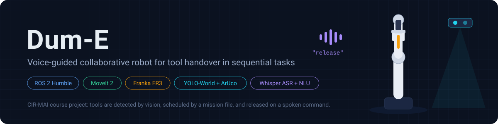
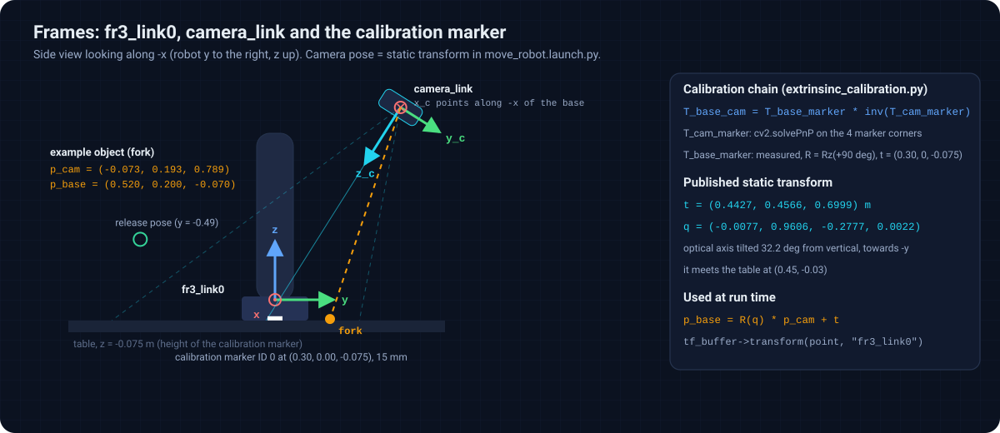
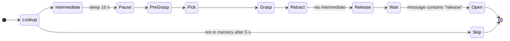

<p align="center">
  
</p>

<p align="center">
  
  
  
  
  
</p>

<p align="center">
  <a href="#how-it-works"><b>How it works</b></a> ·
  <a href="#interactive-documentation"><b>Interactive tour</b></a> ·
  <a href="#usage"><b>Usage</b></a> ·
  <a href="#configuration-reference"><b>Configuration</b></a> ·
  <a href="#known-limitations"><b>Limitations</b></a> ·
  <a href="docs/README.md"><b>Full documentation</b></a>
</p>

**Dum-E** is a ROS 2 system, built for the CIR-MAI course, in which a Franka Research 3 arm hands tools to a person working on a sequential task.
A mission file says which tools are needed and from which second onwards; a RealSense camera finds them on the table with an open-vocabulary detector confirmed by ArUco markers; the arm picks each tool, carries it next to the operator and opens the gripper only when the operator says **"release"**.

## See it run

<p align="center">
  
</p>

The animation replays the shipped mission (`fork`, then `spoon`, then `bottle`). Waypoints, height offsets and log lines are parsed from `monitor_cpp/src/move_to_pose.cpp`; object positions are an example and time is compressed (the fixed 10 s pause before each approach is shown shortened).

## How it works

<p align="center">
  
</p>

Three processes produce information and one consumes it. The pipeline below follows the data in the order in which it flows; each stage links to the chapter of the documentation that derives it in detail.

### 1. Mission: what to fetch, and when

`shared/sequence.json` lists the detector vocabulary (`tools`) and the ordered tasks (`sequence`). The controller processes the tasks strictly in file order and starts task $`k`$ at

```math
d_k = \max\left(s_k - 5\ \text{s},\; f_{k-1}\right),
```

where $`s_k`$ is its `startTime` and $`f_{k-1}`$ the end of the previous task: `startTime` is an earliest start, not a deadline.

<p align="center"></p>

<details>
<summary><b>Details: lookup, skipping, and the frontend editor</b></summary>

* After dispatch, the controller looks the tool up in its object memory for at most 5 s (50 attempts of 100 ms). If it is still unknown, the task is skipped without moving: `SKIPPING: Object '<tool>' never found in vision memory!`
* A tool listed in `sequence` but missing from `tools` can never be detected, because `tools` is the vocabulary given to the detector.
* `frontend/index.html` is an offline editor: it builds tools and sequences, exports `dum-e-sequence.json` (in list order) and stores the user's handedness, which no node reads yet.

Chapter: [2. Mission and scheduling](docs/02-mission-and-scheduling.md)
</details>

### 2. Perception: from pixels to a 3-D point

For every colour frame, `vision_node` asks **YOLO-World** for boxes of the mission's tools, searches each box for an **ArUco** marker, reads the aligned depth at the marker centre and deprojects it with the pinhole model. Only marker-confirmed detections are published, in camera coordinates.

<p align="center"></p>

<details>
<summary><b>Details: the formulas and the publication rule</b></summary>

With intrinsics $`f_x, f_y, c_x, c_y`$ and depth $`D[v,u]`$ in millimetres,

```math
z = \frac{D[v,u]}{1000}, \qquad x = \frac{(u - c_x)\,z}{f_x}, \qquad y = \frac{(v - c_y)\,z}{f_y}.
```

* Detector: `yolov8l-worldv2.pt`, vocabulary set at run time with `set_classes(tools)`, confidence 0.5.
* Markers: `DICT_ARUCO_ORIGINAL`, 15 mm. The marker confirms a detection and gives its reference point; the label comes from the detector.
* Message: `/vision/detected_objects`, a `std_msgs/String` holding JSON such as `[{"label": "fork", "x": -0.073, "y": 0.192, "z": 0.789}]`.
* Boxes without a marker are drawn in green on `/debug_image` and are not published.

Chapter: [3. Perception](docs/03-perception.md)
</details>

### 3. Frames and memory: from the camera to the robot base

A one-off calibration with a marker at a known pose gives the camera pose, published as a static transform. The controller transforms every detection into `fr3_link0` with tf2 and stores it in a memory keyed by label, updated only when the point moves by more than 2 cm.

<p align="center"></p>

<details>
<summary><b>Details: the calibration chain and the memory rule</b></summary>

```math
{}^{base}T_{cam} = {}^{base}T_{marker}\,\left({}^{cam}T_{marker}\right)^{-1}, \qquad p_{base} = R\,p_{cam} + t .
```

$`{}^{cam}T_{marker}`$ comes from `cv2.solvePnP` on the four marker corners; $`{}^{base}T_{marker}`$ is the measured placement $`(0.30, 0, -0.075)`$ m with a $`+90^\circ`$ rotation about $`z`$. The published result places the camera 0.70 m above the base frame, tilted $`32^\circ`$ from the vertical.

Memory entries never expire, there is one entry per label, and the controller copies the entry when a task is dispatched, before a 10 s pause.

Chapter: [4. Calibration, frames and memory](docs/04-calibration-and-frames.md)
</details>

### 4. Voice: from a spoken word to one bit

The browser streams 16 kHz audio to `hmi_server`. An energy-based voice activity detector cuts segments, Whisper transcribes them, a rule-based parser extracts `{action, object}`, and the intent is published on `/hmi/intent_raw`. For the robot only one thing matters: whether a message containing `release` arrives while it waits.

<p align="center"></p>
<p align="center"></p>

<details>
<summary><b>Details: gate, parser and confirmation lock</b></summary>

* Gate: the first 700 ms after server start calibrate the noise level $`\bar\rho`$; speech is any chunk with RMS at least $`\max(0.01, 2.5\bar\rho, 0.0015)`$; a segment closes after 450 ms of silence or 6 s.
* Parser: aliases from `hmi_pkg/config/capabilities.json` plus fixed corrections, matched by phrase, edit distance and a phonetic similarity (threshold 0.75).
* Lock: a complete intent is published immediately with `"allow_execution": false` and locks the page until **Confirm** (which publishes it again with `true`) or **Discard**.
* The controller tests only `msg.data.find("release")`, so the first publication already opens the gripper.

Chapter: [5. Voice interface](docs/05-voice-interface.md)
</details>

### 5. Motion: six straight lines and a grasp

For each task the arm moves along straight Cartesian lines (MoveIt `computeCartesianPath`, 1 cm steps, executed if more than 90 % is feasible) to an intermediate pose, above the object, down to it, back up, to the intermediate pose and to the release pose, where it waits.

<p align="center"></p>

<details>
<summary><b>Details: pick pose, grasp goal and the task state machine</b></summary>

```math
x_p = x_o - 0.02,\quad y_p = y_o - 0.075,\quad
z_p = \begin{cases} -0.024 & z_o < 0.056 \\ z_o - 0.08 & \text{otherwise} \end{cases},\quad
z_{pre} = z_p + 0.103 ,
```

with a fixed top-down orientation (roll 180°, pitch 0°, yaw 90°). The grasp goal is width 0.04 m, force 40 N and tolerance 0.05 m on both sides, so every finger width between 0 and 0.08 m counts as success.



Chapter: [6. Motion and grasping](docs/06-motion-and-grasping.md)
</details>

## Interactive documentation

The [`docs/`](docs/README.md) folder contains a linear, seven-chapter explanation of the algorithms and technologies, and a website that renders the same chapters with **live labs**. The labs run JavaScript ports of the project code; [`docs/tools/check_parity.py`](docs/tools/check_parity.py) verifies them against the original Python modules and the C++ constants.

| Chapter | Lab you can use |
| :------ | :-------------- |
| [1. System overview](docs/01-system-overview.md) | ROS graph explorer: click a node to see topics, parameters and sources |
| [2. Mission and scheduling](docs/02-mission-and-scheduling.md) | Mission planner: edit the JSON and replay the controller's schedule and log |
| [3. Perception](docs/03-perception.md) | Virtual camera with the calibrated extrinsics: move objects, hide markers, read the published message |
| [4. Calibration, frames and memory](docs/04-calibration-and-frames.md) | Rotatable 3-D frames; memory dead band under noisy observations |
| [5. Voice interface](docs/05-voice-interface.md) | VAD on your own microphone; NLU parser with a full decision trace; confirm/lock state machine |
| [6. Motion and grasping](docs/06-motion-and-grasping.md) | Pick-pose calculator; Cartesian path algorithm; grasp tolerance |
| [7. End-to-end run](docs/07-end-to-end-run.md) | Full mission simulator: say "release" with a button and follow arm, schedule and log |

**Open it:** <https://cocopops9.github.io/franka_ros2_language_based_manipulator/>. The site is served by GitHub Pages from the `docs/` folder; if the link does not respond yet, enable it once under *Settings → Pages → Deploy from a branch → `main` / `docs`*. To browse it locally:

```bash
python3 -m http.server 8080 --directory docs   # then open http://localhost:8080
```

## Usage

### Requirements

| Component | Version or note |
| :-------- | :-------------- |
| OS and middleware | Ubuntu 22.04, ROS 2 Humble |
| Robot | Franka Research 3 with the Franka Hand, reachable at `robot_ip` (default `172.16.0.2`) |
| Robot software | [`franka_ros2`](https://github.com/frankaemika/franka_ros2) providing `franka_description`, `franka_fr3_moveit_config`, `franka_msgs` and `franka_gripper`, plus a matching `libfranka` |
| Planning | MoveIt 2 (`moveit_ros_planning_interface`) |
| Camera | Intel RealSense depth camera with `realsense2_camera` and `librealsense2` |
| Vision Python packages | `vision_module/requirements.txt` (`ultralytics`, `torch`, `torchvision`, `opencv-python`, `numpy`, `pyyaml`), `scipy` for calibration, `cv_bridge` from ROS |
| Voice | `hmi_pkg/requirements.txt` (`fastapi`, `uvicorn`, `python-multipart`, `websockets`, `openai`), an OpenAI API key, a browser with a microphone |
| Network | Internet access on first start (YOLO-World weights and the CLIP text encoder are downloaded by Ultralytics) and for every Whisper request |

### 1. Get the code and build

```bash
mkdir -p ~/ros2_ws/src && cd ~/ros2_ws/src
git clone https://github.com/cocopops9/franka_ros2_language_based_manipulator.git
# franka_ros2 must be in this workspace or in a sourced underlay
cd ~/ros2_ws
rosdep install --from-paths src --ignore-src -r -y
pip install -r src/franka_ros2_language_based_manipulator/vision_module/requirements.txt scipy
colcon build --symlink-install --packages-select monitor_cpp vision_module
source install/setup.bash
```

`hmi_pkg` and `frontend` are not colcon packages; they run on their own (steps 5 and 4).

### 2. Adapt the machine-specific paths

| File | What to change |
| :--- | :------------- |
| `vision_module/src/vision_module/vision_node.py` | `package_share_directory = "/home/userlab/cjimenez/franka_ros2_language_based_manipulator"`: set it to your clone, so that the node reads the same `shared/sequence.json` as the controller. |
| `monitor_cpp/launch/move_robot.launch.py` | Nothing to edit: pass `mission_file:=<absolute path>` at launch. |
| `monitor_cpp/CMakeLists.txt` | `link_directories("/home/userlab/cjimenez/ros2_ws/install/franka_msgs/lib")` is only needed on the original lab PC and can be removed. |

### 3. Calibrate the camera (once per camera placement)

1. Print `vision_module/aruco_markers/ID0_15mm.pdf` at 100 % scale and check that the black square measures 15 mm.
2. Lay it flat at $`(0.30, 0.00, -0.075)`$ m in `fr3_link0`, with the top edge of the printed marker facing the robot base: this is the pose hard-coded in `extrinsinc_calibration.py`.
3. With the camera running (`ros2 launch realsense2_camera rs_launch.py align_depth.enable:=true`), run this helper from the repository root:

```python
# calibrate_once.py
# PYTHONPATH=vision_module/src/vision_module/aruco python3 calibrate_once.py
import numpy as np
import rclpy
from rclpy.node import Node
from sensor_msgs.msg import CameraInfo, Image
from cv_bridge import CvBridge
from extrinsinc_calibration import get_camera_transform_from_marker


class CalibrateOnce(Node):
    def __init__(self):
        super().__init__("calibrate_once")
        self.camera_matrix = None
        self.dist_coeffs = None
        self.create_subscription(CameraInfo, "/camera/camera/color/camera_info", self.on_info, 1)
        self.create_subscription(Image, "/camera/camera/color/image_raw", self.on_image, 1)

    def on_info(self, msg):
        self.camera_matrix = np.array(msg.k).reshape(3, 3)
        self.dist_coeffs = np.array(msg.d)

    def on_image(self, msg):
        if self.camera_matrix is None:
            return
        image = CvBridge().imgmsg_to_cv2(msg, "bgr8")
        position, quaternion = get_camera_transform_from_marker(image, self.camera_matrix, self.dist_coeffs)
        if position is not None:
            values = [*position, *quaternion]
            print("static_transform_publisher arguments:", " ".join(f"{v:.4f}" for v in values))
            raise SystemExit


rclpy.init()
rclpy.spin(CalibrateOnce())
```

4. Paste the seven numbers (x, y, z, qx, qy, qz, qw) into the `static_tf` arguments of `monitor_cpp/launch/move_robot.launch.py`.

### 4. Prepare the mission

Edit `shared/sequence.json` directly, or open `frontend/index.html` in a browser, add tools, add steps with their *Ready at (sec)* times, reorder them by dragging, press **Export to JSON** and copy the file over `shared/sequence.json`.
Every `sequence[].tool` must also appear in `tools`. Tool names are text prompts for YOLO-World, so short common nouns work best.

### 5. Run

Start the producers first: the controller's mission clock starts as soon as it has loaded the file.

**Terminal 1: camera and vision**

```bash
source ~/ros2_ws/install/setup.bash
ros2 launch vision_module vision.launch.py
# check: ros2 topic echo /vision/detected_objects
# view:  ros2 run rqt_image_view rqt_image_view /debug_image   (red box = published)
```

**Terminal 2: voice interface**

```bash
cd ~/ros2_ws/src/franka_ros2_language_based_manipulator/hmi_pkg
pip install -r requirements.txt
source /opt/ros/humble/setup.bash
export OPENAI_API_KEY=sk-...
export CAPABILITIES_PATH=$PWD/config/capabilities.json   # otherwise a built-in vocabulary without synonyms is used
export HMI_ROS_ENABLE=1
python3 nodes/hmi_server.py
```

Open <http://localhost:8000> on the same computer (browsers allow the microphone only on `localhost` or HTTPS) and stay silent for the first second: the noise gate is calibrated on the first 700 ms of audio after the server starts.

<details>
<summary>Docker alternative</summary>

```bash
cd hmi_pkg
export OPENAI_API_KEY=sk-...
docker compose up --build
```

`docker-compose.yml` sets `HMI_ROS_ENABLE=0` and a bridge network, so the container does not publish to ROS. To drive the robot from the container, set `HMI_ROS_ENABLE=1` and use host networking (`network_mode: host`) with the same `ROS_DOMAIN_ID` as the robot PC, so that DDS discovery works.
</details>

**Terminal 3: robot, MoveIt and the controller**

```bash
source ~/ros2_ws/install/setup.bash
ros2 launch monitor_cpp move_robot.launch.py \
    robot_ip:=172.16.0.2 \
    mission_file:=$HOME/ros2_ws/src/franka_ros2_language_based_manipulator/shared/sequence.json
```

This launch file also starts the Franka drivers, `move_group`, RViz and the calibrated camera transform.

### 6. Hand over a tool

When the controller logs `WAITING FOR RELEASE...`, hold the tool, press **Start Recording** on the HMI page (or hold the space bar) and say **"release"**. The gripper opens as soon as the transcript is parsed; press **Confirm** or **Discard** afterwards to unlock the page for the next command.

### Test without the full setup

| Missing part | Substitute |
| :----------- | :--------- |
| Robot | `use_fake_hardware:=true` on the robot launch. If no gripper action server is running in that mode, the grasp is skipped after a 5 s wait and opening logs `Gripper Action Server not available!`. |
| Voice stack | `ros2 topic pub --once /hmi/intent_raw std_msgs/msg/String "{data: release}"` |
| Camera | `ros2 topic pub --once /vision/detected_objects std_msgs/msg/String "{data: '[{\"label\": \"fork\", \"x\": -0.073, \"y\": 0.193, \"z\": 0.789}]'}"` (camera frame; becomes roughly (0.52, 0.20, -0.07) in `fr3_link0` with the shipped calibration) |
| ROS, for the HMI | Run `hmi_server.py` without ROS: the bridge disables itself if `rclpy` cannot be imported. `GET /status`, `GET /debug` and the page `/debug/audio` help to tune the audio; `python3 nodes/debug_asr.py file.wav` transcribes a file. |
| New fixed poses | `ros2 run monitor_cpp pose_monitor` prints the TCP position and roll, pitch, yaw at 10 Hz; paste the values into `create_pose(...)`. |

### Configuration reference

<details>
<summary><b>Controller</b> (<code>monitor_cpp/src/move_to_pose.cpp</code>, <code>move_robot.launch.py</code>)</summary>

| Name | Value | Meaning |
| :--- | :---- | :------ |
| `robot_ip` | `172.16.0.2` | launch argument |
| `use_fake_hardware` | `false` | launch argument |
| `mission_file` | absolute path | launch argument and node parameter |
| planning group, end effector | `fr3_arm`, `fr3_hand_tcp` | MoveGroupInterface |
| velocity, acceleration scaling | 0.15, 0.15 | MoveGroupInterface |
| `travel_time_offset` | 5.0 s | a task may start at `startTime - 5 s` |
| memory lookup | 50 x 100 ms | then the task is skipped |
| memory update threshold | 0.02 m | dead band of the object memory |
| intermediate pose | (0.45, 0.00, 0.35), RPY (179.5, -5.8, -2.0) deg | |
| release pose | (0.598, -0.490, 0.22), RPY (179.9, -3.9, -92.2) deg | a left-hand variant (0.219, -0.455, 0.22) is commented out |
| pick offsets | x − 0.02, y − 0.075; z = −0.024 if z < 0.056, else z − 0.08 | |
| pre-grasp hover | +0.103 m | |
| pause before the approach | 10 s | |
| Cartesian path | eef_step 0.01 m, jump_threshold 0.0, execute if fraction > 0.90 | |
| grasp goal | width 0.04 m, speed 0.1 m/s, force 40 N, epsilon 0.05 / 0.05 m | `/franka_gripper/grasp` |
| open goal | width 0.08 m, speed 0.1 m/s | `/franka_gripper/move` |
| camera transform | t = (0.4427, 0.4566, 0.6999), q = (-0.0077, 0.9606, -0.2777, 0.0022) | `fr3_link0` to `camera_link` |
</details>

<details>
<summary><b>Vision</b> (<code>vision_module/</code>)</summary>

| Name | Value |
| :--- | :---- |
| detector | `yolov8l-worldv2.pt`, confidence 0.5, classes = `tools` of the mission file |
| marker dictionary and size | `DICT_ARUCO_ORIGINAL`, 0.015 m |
| inputs | `/camera/camera/color/image_raw`, `/camera/camera/aligned_depth_to_color/image_raw`, `/camera/camera/color/camera_info` |
| outputs | `/vision/detected_objects` (JSON in `camera_link`), `/debug_image` |
| RealSense options | `align_depth.enable: true`, `pointcloud.enable: false` (in `vision.launch.py`) |

`vision_module/config/yolo.yaml` and `config/tools.json` are not read by the current node.
</details>

<details>
<summary><b>Voice interface</b> (environment variables of <code>hmi_pkg/nodes/config.py</code>)</summary>

| Variable | Default | Effect |
| :------- | :------ | :----- |
| `OPENAI_API_KEY` | none | required for transcription |
| `CAPABILITIES_PATH` | `/app/hmi_pkg/config/capabilities.json` | vocabulary file; the default exists only in the Docker image |
| `HMI_ROS_ENABLE` | `1` (`0` in `docker-compose.yml`) | start the ROS bridge |
| `HMI_ROS_INTENT_TOPIC`, `HMI_ROS_ASR_TOPIC` | `/hmi/intent_raw`, `/hmi/asr_text` | topics |
| `HMI_ROS_CONFIRM_MODE` | `intent` | on Confirm, publish the intent (`intent`) or the transcript (any other value) |
| `WHISPER_MODEL`, `WHISPER_LANG` | `whisper-1`, `en` | transcription request |
| `WHISPER_USE_PROMPT`, `WHISPER_TEMPERATURE` | `0`, `0` | vocabulary prompt, sampling temperature |
| `WHISPER_MIN_RMS`, `WHISPER_BYPASS_RMS` | `0.01`, `0` | minimum segment RMS before upload |
| `ASR_MIN_MS`, `ASR_DEDUP_MS` | `300`, `1700` | minimum segment length; duplicate window |
| `EN_ONLY_STRICT` | `1` | discard transcripts with non-ASCII characters |
| `VAD_CALIB_SEC`, `VAD_GATE_MULT`, `VAD_MIN_RMS_FLOOR` | `0.7`, `2.5`, `0.0015` | noise calibration and gate |
| `VAD_MIN_MS`, `VAD_SIL_HANG_MS`, `VAD_MAX_UTT_MS` | `180`, `450`, `6000` | segment limits |
| `INTENT_MERGE_MS`, `LOCK_ON_INTENT` | `900`, `1` | merge window for split commands; lock after an intent |
| `NLU_ACTION_THRESHOLD`, `NLU_OBJECT_THRESHOLD` | `0.75`, `0.75` | phonetic similarity thresholds |
| `ASR_DROP_LOWCONF_SINGLE_ACTION`, `ASR_LOWCONF_RMS_MULT`, `ASR_LOWCONF_MAX_MS` | `1`, `1.25`, `1000` | low-confidence filter |
| `HMI_INDEX_HTML` | `hmi_pkg/public/index.html` | page served at `/` |

`WHISPER_CHUNK_SEC` is reported by `/debug` but not used by the pipeline.
</details>

### Troubleshooting

| Symptom | Most likely cause |
| :------ | :---------------- |
| `SKIPPING: Object 'X' never found in vision memory!` | `X` not in `tools`, no visible marker, depth hole, the two nodes read different mission files, or the camera transform is missing. |
| The arm waits forever at the release pose | The ROS bridge is off (`HMI_ROS_ENABLE=0`), DDS cannot reach the HMI process, or "release" was said before the arm arrived (it is ignored then). |
| No transcript | Missing API key, a segment shorter than 300 ms or quieter than RMS 0.01, or a gate raised by speech during calibration: restart the server in silence. |
| The parser returns an unexpected intent | Multi-word aliases never match as phrases, and ties depend on `PYTHONHASHSEED`; see [Chapter 5](docs/05-voice-interface.md#verified-behaviours-of-the-parser). |

The complete diagnosis table is in [Chapter 7](docs/07-end-to-end-run.md#73-failure-modes-and-diagnosis).

## Repository layout

```text
franka_ros2_language_based_manipulator/
├── monitor_cpp/                  ROS 2 C++ package
│   ├── src/move_to_pose.cpp      mission controller (vision memory, scheduler, pick and handover)
│   ├── src/pose_monitor.cpp      prints the TCP pose, for teaching fixed poses
│   ├── launch/move_robot.launch.py   Franka MoveIt stack + camera transform + controller
│   └── include/nlohmann/json.hpp     vendored JSON parser
├── vision_module/                ROS 2 Python package
│   ├── src/vision_module/vision_node.py               YOLO-World + ArUco + depth + deprojection
│   ├── src/vision_module/yolo_detector_ultralytics.py  open-vocabulary detector wrapper
│   ├── src/vision_module/aruco/extrinsinc_calibration.py  camera pose from one marker
│   ├── launch/vision.launch.py   RealSense driver + vision node
│   └── aruco_markers/            printable markers (15 mm sheets match the code)
├── hmi_pkg/                      voice interface (FastAPI, not a colcon package)
│   ├── nodes/                    server, VAD, Whisper client, NLU, ROS bridge, state
│   ├── config/capabilities.json  actions, objects and synonyms
│   ├── public/index.html         microphone page served at /
│   └── Dockerfile, docker-compose.yml
├── frontend/                     offline mission editor (HTML/JS)
├── shared/sequence.json          the mission
└── docs/                         guided documentation, interactive site, figures and their generators
```

## Known limitations

The documentation states these explicitly so that results are interpreted correctly; [Chapter 7](docs/07-end-to-end-run.md#74-known-limitations) explains each one.

1. Absolute paths of the original lab PC in `vision_node.py`, in defaults of the controller and in `CMakeLists.txt`.
2. Handedness is exported by the frontend but not used; the left-hand release pose is commented out.
3. The release trigger is a substring test; `allow_execution` and the confirmation are ignored by the controller.
4. The grasp tolerance accepts any finger width, and the grasp result is not checked.
5. Cartesian paths are executed when more than 90 % is feasible, without a joint-jump check.
6. Object memory entries never expire and are read once per task, before a 10 s pause.
7. Parser quirks: multi-word aliases are unreachable as phrases; tie-breaking depends on the Python hash seed.
8. The noise gate is calibrated once per server start; the synchronous Whisper call blocks the server's event loop.
9. Depth is read at a single pixel, without colour and depth synchronisation.

## Keeping the documentation true to the code

```bash
python3 docs/tools/check_parity.py    # Python and C++ sources against the JavaScript used by the labs
python3 docs/tools/generate_svgs.py   # regenerate every animated figure from the sources
```

`check_parity.py` needs only `python3` and `node`; it runs the HMI modules under 24 hash seeds on 692 phrases, 996 audio chunks and 12 dialogues, and compares 9 groups of controller constants with `move_to_pose.cpp` and the launch file.

## Contributors

Developed for the CIR-MAI course by the contributors listed in the commit history: [@CaJiFan](https://github.com/CaJiFan), [@simwim21](https://github.com/simwim21) and [@cocopops9](https://github.com/cocopops9).
The repository does not contain a licence file; ask the authors before reusing the code.
