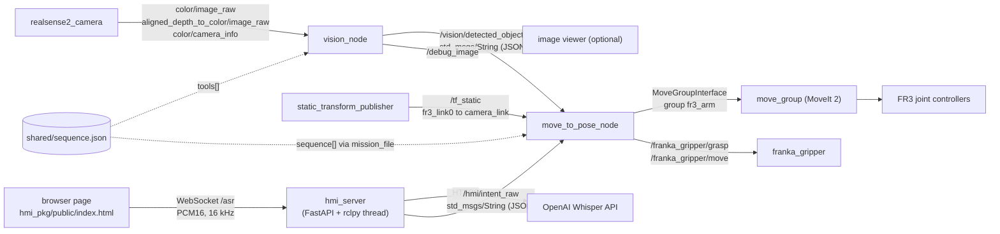
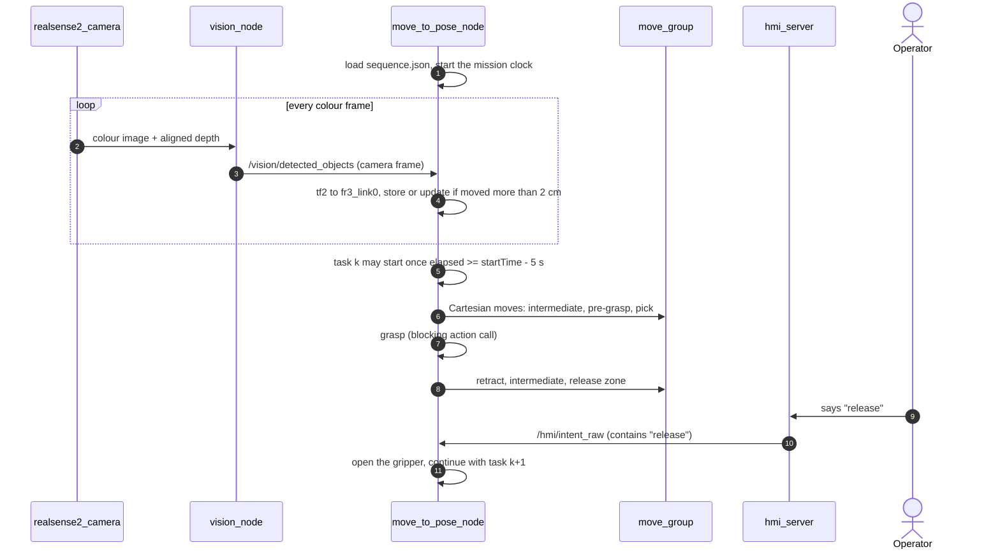

# 1. System overview

[Docs index](README.md) · **1. Overview** · [2. Mission](02-mission-and-scheduling.md) · [3. Perception](03-perception.md) · [4. Frames](04-calibration-and-frames.md) · [5. Voice](05-voice-interface.md) · [6. Motion](06-motion-and-grasping.md) · [7. End to end](07-end-to-end-run.md)

Dum-E is a collaborative tool-handover assistant built on a Franka Research 3 (FR3) arm.
A mission file lists which tools are needed and from which second onwards; a depth camera finds the tools on the table;
the arm picks each tool, carries it to a fixed handover pose next to the operator, and opens the gripper only when the operator says **"release"**.

## 1.1 Components

| Folder | Kind | Language | Entry point | Role |
| :----- | :--- | :------- | :---------- | :--- |
| `vision_module/` | ROS 2 package (`ament_python`) | Python | `ros2 launch vision_module vision.launch.py` | Starts the RealSense driver and `vision_node`: open-vocabulary detection, ArUco check, depth, deprojection. |
| `monitor_cpp/` | ROS 2 package (`ament_cmake`) | C++17 | `ros2 launch monitor_cpp move_robot.launch.py` | Starts MoveIt 2 for the FR3, the calibrated camera transform and `move_to_pose_node`, the mission controller. Also contains `pose_monitor`, a tool that prints the current TCP pose. |
| `hmi_pkg/` | Stand-alone FastAPI service (not a colcon package) | Python | `python3 nodes/hmi_server.py` or Docker | Browser microphone streaming, voice activity detection, Whisper transcription, intent parsing, confirmation lock, ROS publication. |
| `frontend/` | Static web page | HTML/JS | open `frontend/index.html` | Editor for tool lists and timed sequences; exports a JSON mission file. It does not talk to ROS. |
| `shared/` | Data | JSON | `shared/sequence.json` | The mission: tool vocabulary for the detector and the ordered pick sequence for the controller. |

## 1.2 ROS graph

All camera topics live under the `/camera/camera/` namespace created by `realsense2_camera`.

## 1.3 Data contracts

Every interface between components, with the exact payloads the code produces or expects.

| Interface | Type | Producer to consumer | Content |
| :-------- | :--- | :------------------- | :------ |
| `/camera/camera/color/image_raw` | `sensor_msgs/Image` | camera to `vision_node` | Colour frames, converted to `bgr8`. |
| `/camera/camera/aligned_depth_to_color/image_raw` | `sensor_msgs/Image` (16-bit) | camera to `vision_node` | Depth registered to colour pixels, in millimetres; only the latest frame is kept. |
| `/camera/camera/color/camera_info` | `sensor_msgs/CameraInfo` | camera to `vision_node` | The 3×3 matrix $`K`$, read once. |
| `/vision/detected_objects` | `std_msgs/String` | `vision_node` to `move_to_pose_node` | JSON list, one entry per marker-confirmed detection, camera frame, metres: `[{"label": "fork", "x": -0.073, "y": 0.192, "z": 0.789}]`. Published for every colour frame, possibly `[]`. |
| `/debug_image` | `sensor_msgs/Image` | `vision_node` | Annotated frame: red boxes (`ARUCO`), green boxes (`YOLO` only). |
| `/tf_static` | `tf2_msgs/TFMessage` | `static_transform_publisher` | `fr3_link0` to `camera_link`, from the extrinsic calibration. |
| `/hmi/intent_raw` | `std_msgs/String` | `hmi_server` to `move_to_pose_node` | Compact JSON, for example `{"action":"release","object":null,"allow_execution":false}`. |
| `/hmi/asr_text` | `std_msgs/String` | `hmi_server` | Raw transcript, published on confirmation only if `HMI_ROS_CONFIRM_MODE` is not `intent` (the default is `intent`). |
| `/franka_gripper/grasp` | `franka_msgs/action/Grasp` | `move_to_pose_node` to `franka_gripper` | width 0.04 m, speed 0.1 m/s, force 40 N, epsilon 0.05 m inner and outer. |
| `/franka_gripper/move` | `franka_msgs/action/Move` | `move_to_pose_node` to `franka_gripper` | width 0.08 m, speed 0.1 m/s. |
| `move_group` | MoveIt 2 services and actions | `move_to_pose_node` to `move_group` | Cartesian path computation, trajectory execution, the named target `ready`. |
| WebSocket `/asr` (alias `/ws`) | binary PCM16 up, JSON text down | browser and `hmi_server` | Up: audio. Down: `status`, `rms`, `bytes`, `calibrated`, `final`, `intent`, `locked`, `confirmed`, `discarded`, `error`. |
| HTTP | `POST /confirm`, `/discard`, `/unlock`; `GET /status`, `/debug`, `/debug/audio` | browser to `hmi_server` | Confirmation protocol and diagnostics. |

## 1.4 One run, at a glance

## 1.5 Concurrency model

The three runtime processes use different concurrency schemes, and the differences explain several behaviours described later.

* **`move_to_pose_node`** creates a `MultiThreadedExecutor` and spins it in a separate `std::thread`.
  The main thread executes the whole mission as straight-line, *blocking* code: sleeps, MoveIt planning and execution, and gripper actions awaited through `std::promise`/`std::future`.
  Subscription callbacks run on executor threads; the object memory is protected by a `std::mutex` and the release flag is a `std::atomic<bool>`.
  Because the executor runs elsewhere, blocking the main thread never starves the callbacks.
* **`vision_node`** is single-threaded (`rclpy.spin`). YOLO inference runs inside the colour-image callback, so the processing rate is bounded by the inference time; the depth callback only stores the latest depth frame.
* **`hmi_server`** runs on the asyncio event loop of Uvicorn (WebSocket and HTTP handlers) and starts a daemon thread with its own `rclpy` node. Messages cross threads through a `queue.Queue` that a 50 ms ROS timer drains.

<!-- lab:rosgraph -->
> **Interactive lab:** [explore the ROS graph](https://cocopops9.github.io/franka_ros2_language_based_manipulator/#/01-system-overview?lab=rosgraph): click a node to see what it subscribes to, publishes and reads.

## 1.6 What to take away

1. Perception and voice are *producers*; the controller is the only *consumer* that moves hardware.
2. The camera node publishes coordinates in the **camera** frame; the transformation to the robot frame happens in the controller.
3. The controller follows the mission file on its own clock. The voice channel influences exactly one decision: when to open the gripper at the handover pose.

<b>Next:</b> <a href="02-mission-and-scheduling.md">2. Mission and scheduling</a>

