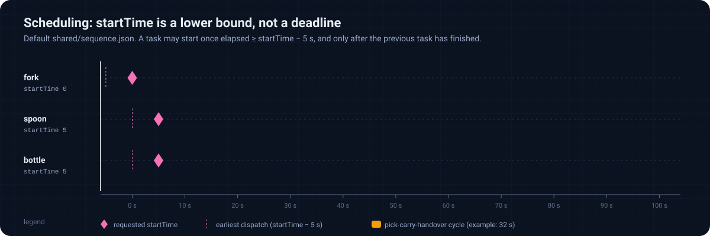

# 2. Mission and scheduling

[Docs index](README.md) · [1. Overview](01-system-overview.md) · **2. Mission** · [3. Perception](03-perception.md) · [4. Frames](04-calibration-and-frames.md) · [5. Voice](05-voice-interface.md) · [6. Motion](06-motion-and-grasping.md) · [7. End to end](07-end-to-end-run.md)

The mission file is the single source of truth for *what* the robot fetches and *in which order*.
This chapter describes the file, the editor that produces it, and the exact rule the controller uses to decide when a task starts.

## 2.1 The mission file

`shared/sequence.json` as shipped:

```json
{
  "project": "Dum-E",
  "tools": ["bottle", "spoon", "fork"],
  "sequence": [
    { "tool": "fork",   "startTime": 0 },
    { "tool": "spoon",  "startTime": 5 },
    { "tool": "bottle", "startTime": 5 }
  ]
}
```

Two different programs read it, and each one reads different fields:

| Field | Read by | Meaning in the code |
| :---- | :------ | :------------------ |
| `project` | `move_to_pose_node` | Printed in the log (`[SYSTEM] Loading Project: Dum-E`). |
| `tools` | `vision_node` | The detector vocabulary: `YOLODetectorUltralytics.set_classes(tools)`. Class index $`i`$ of a detection is mapped back to `tools[i]`. |
| `sequence[].tool` | `move_to_pose_node` | Key used to look the object up in the vision memory; it must equal a detector label. |
| `sequence[].startTime` | `move_to_pose_node` | Seconds after the controller starts, converted to an integer. |
| `handedness` | nobody | Written by the frontend export; neither node reads it (the left-hand release pose exists only as a commented line in `move_to_pose.cpp`). |

Two consequences follow directly:

* A tool that appears in `sequence` but not in `tools` can never be detected, so its task is skipped after the 5 s memory lookup.
* Both nodes must read **the same file**. The controller receives the path through the `mission_file` launch argument; `vision_node.py` builds it from a hard-coded directory (`/home/userlab/cjimenez/franka_ros2_language_based_manipulator`), which has to be edited on another machine. If that file cannot be read, the vision node falls back to `['bottle', 'fork', 'spoon']`.

## 2.2 The frontend editor

`frontend/index.html` is a self-contained page that edits missions. It lets the operator add tools, append sequence steps (each new step defaults to the previous start time plus 10 s), reorder steps by drag and drop, set the user's handedness, and export or import the JSON file.

What it does **not** do matters as much:

* Export writes the steps in **list order**, which becomes the execution order. The *Start Sequence* button only sorts a copy by time for a browser alert; it does not contact ROS.
* The voice recorder on that page records locally for playback; the audio is not sent anywhere. Live voice control is the separate page served by `hmi_server` (Chapter 5).
* The exported file is named `dum-e-sequence.json`; it must be copied over `shared/sequence.json` (or passed as `mission_file`) by hand.

## 2.3 When does a task start?

Let tasks be indexed in file order $`k = 1, \dots, n`$, with start times $`s_k`$, and let $`\Delta = 5\ \text{s}`$ be `travel_time_offset`.
The controller processes tasks strictly one after another; inside the wait loop it leaves as soon as $`s_k - t - \Delta \le 0`$, where $`t`$ is the time since the mission was loaded.
If $`f_{k-1}`$ denotes the time at which task $`k-1`$ finished ($`f_0 = 0`$), the dispatch time is therefore

```math
d_k = \max\left(s_k - \Delta,\; f_{k-1}\right).
```

`startTime` is therefore a **lower bound**, not a schedule: a task is never started early, but it can start arbitrarily late if the previous cycle takes longer than the gap between start times.

<p align="center"></p>

Implementation details that refine the formula:

* The loop polls every 100 ms. When $`\lfloor t \rfloor`$ is a multiple of 5 it prints `Waiting... T-minus ... sec` and sleeps 1005 ms instead, so a dispatch can be up to about one second late.
* Tasks are **not sorted**; a later entry with a smaller `startTime` simply runs immediately after its predecessor.
* `startTime` is converted to `int`, so `2.7` becomes `2`.

After dispatch, the controller looks the tool up in its vision memory, retrying every 100 ms for at most 50 attempts:

```math
t_{\text{lookup}} \le 50 \times 0.1\ \text{s} = 5\ \text{s}.
```

If the label is still unknown it logs `SKIPPING: Object '<tool>' never found in vision memory!` and continues with the next task without moving.

## 2.4 How long is one cycle?

The duration of a task, $`f_k - d_k`$, is the sum of fixed and variable parts read from `move_to_pose.cpp`:

```math
f_k - d_k = \underbrace{10 + 1 + 1}_{\text{fixed sleeps}} + T_{\text{motion}} + T_{\text{grasp}} + T_{\text{open}} + T_{\text{human}},
```

where $`T_{\text{motion}}`$ covers six Cartesian moves executed at 15 % of the maximum velocity and acceleration, the gripper terms are the action durations, and $`T_{\text{human}}`$ is the time until the operator says "release".
With the shipped file, the tasks with `startTime` 5 start immediately after the previous one, because every cycle lasts more than 12 s.

<!-- lab:mission -->
> **Interactive lab:** [plan a mission](https://cocopops9.github.io/franka_ros2_language_based_manipulator/#/02-mission-and-scheduling?lab=mission): edit the JSON, hide tools from the camera, and watch the controller's schedule and log.

## 2.5 What to take away

1. `tools` drives perception, `sequence` drives the controller: they must be consistent.
2. Execution is sequential in file order; `startTime − 5 s` is the earliest dispatch time.
3. A missing detection costs 5 s and skips the task; it never blocks the mission.

<p align="right"><b>Next:</b> <a href="03-perception.md">3. Perception</a></p>
