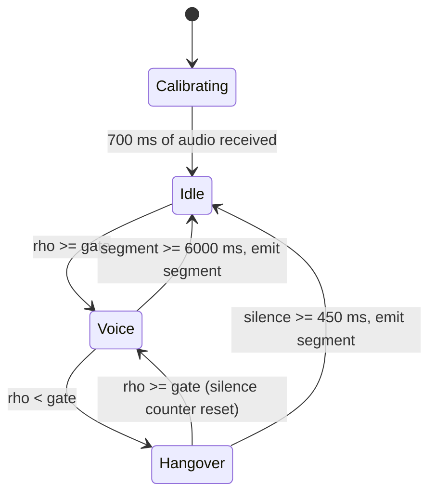
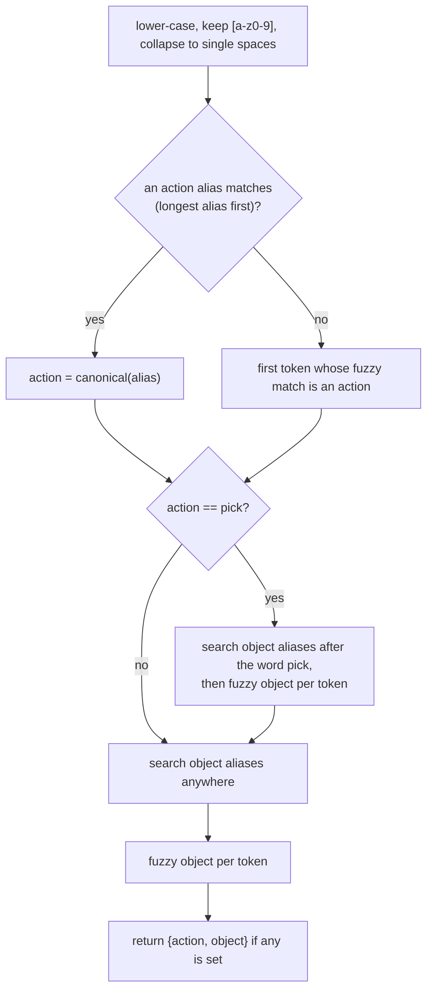
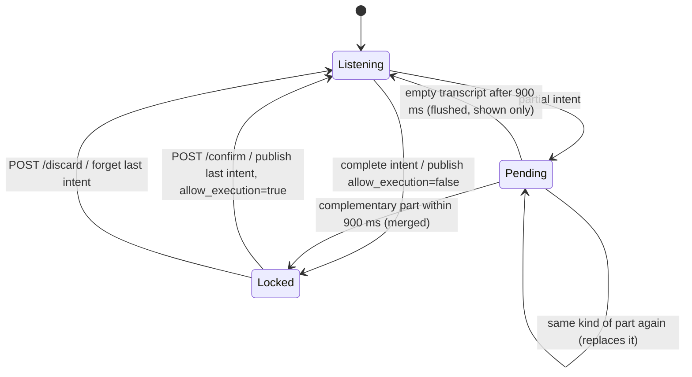

# 5. Voice interface

[Docs index](README.md) · [1. Overview](01-system-overview.md) · [2. Mission](02-mission-and-scheduling.md) · [3. Perception](03-perception.md) · [4. Frames](04-calibration-and-frames.md) · **5. Voice** · [6. Motion](06-motion-and-grasping.md) · [7. End to end](07-end-to-end-run.md)

The voice channel turns speech into a small JSON intent on `/hmi/intent_raw`.
It is a pipeline of six stages, all in `hmi_pkg/`: capture in the browser, voice activity detection (VAD), transcription with Whisper, transcript filters, natural language understanding (NLU), and intent assembly with a confirmation lock.

<p align="center"></p>

## 5.1 Capture in the browser

`hmi_pkg/public/index.html` (served at `/` by `hmi_server`) requests the microphone with echo cancellation, noise suppression and automatic gain control, applies a fixed gain of 1.5, and processes audio in blocks of 2048 samples (`ScriptProcessorNode`).
Each block is downsampled to 16 kHz by averaging consecutive input samples, with ratio $`r = f_{in} / 16000`$:

```math
y[o] = \frac{1}{|I_o|} \sum_{i \in I_o} x[i], \qquad I_o = \left[\operatorname{round}(o\,r),\ \operatorname{round}((o+1)\,r)\right),
```

then converted to 16-bit integers and sent as a binary WebSocket message to `/asr`. At $`f_{in} = 48`$ kHz a block becomes 683 samples, that is **42 ms** of audio.
The page also offers push-to-talk on the space bar and stops sending audio while the server reports `locked`.

## 5.2 Voice activity detection

`hmi_pkg/nodes/vad.py` is an energy detector with a calibrated threshold and a hang-over. For a chunk of $`N`$ samples,

```math
\rho = \frac{1}{32768}\sqrt{\frac{1}{N}\sum_{n=1}^{N} x_n^2}.
```

**Calibration.** The first 700 ms of audio after the server starts are treated as noise. The average chunk RMS $`\bar\rho`$ sets the gate

```math
\gamma = \max\left(0.01,\; 2.5\,\bar\rho,\; 0.0015\right).
```

The term 0.01 (`WHISPER_MIN_RMS`) dominates whenever $`\bar\rho < 0.004`$.

**Segmentation.** A chunk is *voiced* if $`\rho \ge \gamma`$. A segment opens at the first voiced chunk and accumulates every following chunk, voiced or not. It closes when the accumulated silence reaches 450 ms, or when the segment reaches 6 s.



<p align="center"></p>

Three consequences can be read off the code and are visible in the trace above, which was computed by `vad.py` itself:

* **The minimum length never triggers with the defaults.** A segment closed by silence contains at least 450 ms of hang-over, and $`450 > 180`$ (`VAD_MIN_MS`), so the length test cannot reject it. A 60 ms click becomes a 554 ms segment.
* **Calibration is global and happens once.** The VAD state lives in a single `WebSocketHandler` created at import time and is reset only at server start-up, not per connection. Speaking during the first 700 ms raises the gate for the whole session.
* **While locked, audio is ignored** before it reaches the VAD.

<!-- lab:vad -->
> **Interactive lab:** [run the VAD on your microphone](https://cocopops9.github.io/franka_ros2_language_based_manipulator/#/05-voice-interface?lab=vad): the browser applies the same capture chain and the same state machine, and shows which segments would be uploaded.

## 5.3 Transcription with Whisper

Before a segment is uploaded, `transcribe_with_openai()` applies two checks and a gain:

```math
\text{send} \iff T_{seg} \ge 300\ \text{ms} \ \wedge\ \rho_{seg} \ge 0.01,
\qquad
g = \begin{cases} \min\!\left(3,\ \dfrac{0.03}{\max(0.001,\ \rho_{seg})}\right) & \rho_{seg} < 0.03 \\ 1 & \text{otherwise.} \end{cases}
```

The amplified segment is written as a mono 16-bit WAV file and sent to the OpenAI transcription endpoint with `model="whisper-1"` and `language="en"`; the vocabulary prompt is disabled by default (`WHISPER_USE_PROMPT=0`).
Whisper (Radford et al., *Robust Speech Recognition via Large-Scale Weak Supervision*, 2022) is an encoder-decoder Transformer that reads a log-Mel spectrogram and generates text tokens; like any generative recogniser it can produce text for non-speech input, which is why the next stage exists.

The returned text is post-processed with fixed rewrites (case-insensitive):

| Pattern | Replacement |
| :------ | :---------- |
| `ike aken`, `peak can` | `pick can` |
| `picca botto`, `picca boto` (space optional), `pick bottal`, `pick botal` | `pick bottle` |
| `council`, `counsel` | `cancel` |
| `rel ease` | `release` |

Any non-ASCII character empties the transcript (`EN_ONLY_STRICT=1`).

Note that the OpenAI client is the synchronous one, called inside the asynchronous WebSocket handler: the server's event loop is blocked for the duration of each request.

## 5.4 Transcript filters

| Filter | Rule | Default |
| :----- | :--- | :------ |
| Low confidence | Drop if the lower-cased text is exactly one of `release, stop, next, cancel, pick` (optionally followed by `cup, bottle, mug, can`), **and** $`\rho_{seg} < 1.25\,\gamma`$, **and** $`T_{seg} \le 1000`$ ms. Text with punctuation, such as `Release.`, does not match. | on |
| Duplicate | Drop if the normalised text equals the previous transcript and arrived less than 1700 ms later. | 1700 ms |
| Too short | After parsing, reject the intent if the transcript has at most 3 characters. | 3 |

Each accepted transcript receives a signature `u00000001`, `u00000002`, ... and is sent to the browser as `{"type": "final", ...}`.

## 5.5 Natural language understanding

`hmi_pkg/nodes/nlu_engine.py` maps a transcript to `{"action": a, "object": o}` with $`a \in`$ {pick, release, next, stop, cancel} and $`o \in`$ {cup, bottle, mug, can, item}, each possibly `null`.

**Vocabulary.** Aliases come from `config/capabilities.json` (`actions`, `objects`, `synonyms`) plus two hard-coded correction tables in `NLU.load()` (for example `peek`, `pig` for *pick*; `cub`, `kup` for *cup*). The `phonetic_corrections`, `standalone_actions` and `object_required_actions` blocks of the JSON file are not read.
The file is found through `CAPABILITIES_PATH`, whose default `/app/hmi_pkg/config/capabilities.json` exists only inside the Docker image. Without it, the parser silently falls back to five actions and four objects without synonyms.

**Algorithm.**



**Fuzzy matching.** For a token $`a`$ and an alias $`b`$ the parser computes the Levenshtein distance $`D_c`$ (with early exit above a cutoff $`c`$) and a phonetic similarity. With $`\varphi`$ the phonetic normalisation (replace `ck`, `ph`, `gh`, then map each letter through c→k, k→c, s→z, z→s, f→v, v→f, b→p, p→b, d→t, t→d, g→k, x→ks) and $`\kappa`$ the removal of vowels:

```math
\operatorname{sim}(a,b) =
\begin{cases}
1 & a = b \\
0.95 & \varphi(a) = \varphi(b) \\
\min\!\Big(1,\ 1 - \dfrac{D_4(\varphi a, \varphi b)}{\max(|\varphi a|, |\varphi b|)} + 0.1\,[a_1 = b_1] + 0.15\Big(1 - \dfrac{D_3(\kappa a, \kappa b)}{\max(|\kappa a|, |\kappa b|)}\Big)\Big) & \text{otherwise.}
\end{cases}
```

Over all aliases, the parser keeps the best similarity and the smallest distance. An **action** is accepted if the best similarity is at least 0.75 (`NLU_ACTION_THRESHOLD`), otherwise if the closest alias is within edit distance 2 (3 for *cancel*). An **object** is accepted with similarity at least 0.75, otherwise within distance 2.
Because the letter map swaps pairs (c→k but k→c), $`\varphi(a) = \varphi(b)`$ holds only when the words differ in letters that map to the same image, such as *c* and *g* (both become *k*), or in the digraphs.

<!-- lab:nlu -->
> **Interactive lab:** [type a sentence and see every decision](https://cocopops9.github.io/franka_ros2_language_based_manipulator/#/05-voice-interface?lab=nlu): the browser runs a port of `nlu_engine.py` that `check_parity.py` verifies against the Python code.

### Verified behaviours of the parser

`docs/tools/check_parity.py` runs the Python parser under 24 values of `PYTHONHASHSEED` on a synthetic corpus of 692 phrases (vocabulary words, random misspellings, random combinations). Two properties stand out.

1. **Multi-word aliases never match as phrases.** `_compile_phrase` applies `re.escape` first, which turns `pick up` into `pick\ up`, and then replaces the whitespace by `\s+`. The final pattern is `pick\\s+up`: a literal backslash followed by one or more `s`. Cleaned text never contains a backslash, so `pick up`, `let go`, `never mind`, `coffee cup`, `soda can` and every other multi-word alias are only reachable through single-token fuzzy matching, sometimes with surprising results: `let go` (listed as a synonym of *release*) parses as `{"action": "pick", "object": "can"}`, because *let* is one edit away from *get* (a synonym of *pick*) and two edits away from *ken* (a correction for *can*).
2. **Ties depend on the hash seed.** Equal-length phrase matches and equal fuzzy scores are resolved by the iteration order of Python `set`s, which depends on string-hash randomisation and therefore changes between server restarts. In the corpus, **192 of 692 phrases** produced different results across the 24 seeds. Examples: `pick next` gives *pick* or *next*; the single word `can` gives *cancel* or no action; `drop it` gives *release* with object *can* or *item*.

The object vocabulary of the parser (cup, bottle, mug, can, item) differs from the detector vocabulary (fork, spoon, bottle); this has no effect on the robot, because the controller ignores the object field (Section 5.7).

## 5.6 Intent assembly and the confirmation lock

`websocket_handler.py` decides what to do with a parsed result:

* **Complete**: an action with an object, or one of the standalone actions `next, stop, cancel, release`. The special case `cancel` + `can` is reduced to `cancel`; it arises because the token *cancel* also matches the object alias *cane* (phonetic similarity 0.84). A complete intent is sent to the browser, **published immediately** on `/hmi/intent_raw` with `"allow_execution": false`, and locks the system.
* **Partial**: `pick` without an object, or an object without an action. It is stored with a time stamp and merged with the complementary part if that arrives within 900 ms (`INTENT_MERGE_MS`). A merged intent locks the system but is **not** published until confirmation. A pending part is flushed to the browser only when a later segment produces an empty transcript at least 900 ms after it was stored; a flushed part neither locks nor publishes.

Each segment ends only after 450 ms of silence and then waits for a Whisper round trip, so two transcripts arriving within 900 ms are uncommon; in practice a command split over two utterances usually stays partial.



While locked, the page disables the microphone and enables **Confirm** and **Discard**. `POST /confirm` publishes the last intent again with `"allow_execution": true`; `POST /discard` clears it.

<!-- lab:intent -->
> **Interactive lab:** [drive the lock state machine](https://cocopops9.github.io/franka_ros2_language_based_manipulator/#/05-voice-interface?lab=intent): say phrases at chosen times, confirm or discard, and inspect every WebSocket and ROS message.

## 5.7 What the controller does with an intent

`move_to_pose.cpp` subscribes to `/hmi/intent_raw` and performs a single test:

```cpp
if (msg->data.find("release") != std::string::npos) release_signal_received = true;
```

Hence:

* The **first** publication, with `allow_execution: false`, already opens the gripper; confirmation is not required by the controller.
* The `action`, `object` and `allow_execution` fields are not parsed. Any message containing the substring `release` counts, including `ros2 topic pub --once /hmi/intent_raw std_msgs/msg/String "{data: release}"`, which is convenient for testing without the voice stack.
* The flag is cleared when the arm *starts* waiting at the release pose, so a "release" spoken earlier is ignored, and the second publication triggered by **Confirm** is harmless.
* `pick`, `next`, `stop` and `cancel` have no effect on the robot.

## 5.8 What to take away

1. The VAD is an energy gate calibrated once per server start; its hang-over sets the minimum segment length.
2. The parser is a rule system on top of edit distance and a phonetic score, with two verified quirks: multi-word aliases are unreachable as phrases, and ties depend on the hash seed.
3. For the robot, the whole voice stack reduces to one bit: whether a message containing `release` arrived while the arm was waiting.

<p align="right"><b>Next:</b> <a href="06-motion-and-grasping.md">6. Motion and grasping</a></p>
