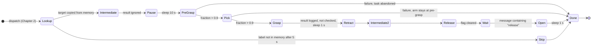

# 6. Motion and grasping

[Docs index](README.md) · [1. Overview](01-system-overview.md) · [2. Mission](02-mission-and-scheduling.md) · [3. Perception](03-perception.md) · [4. Frames](04-calibration-and-frames.md) · [5. Voice](05-voice-interface.md) · **6. Motion** · [7. End to end](07-end-to-end-run.md)

Once a tool has a position in `fr3_link0`, `move_to_pose_node` executes a fixed choreography of six straight-line moves and two gripper actions.
This chapter derives every pose, explains how MoveIt turns a pose into a straight-line path, and states precisely when the grasp is considered successful.

<p align="center"></p>

## 6.1 Planning setup

`move_robot.launch.py` includes `franka_fr3_moveit_config/launch/moveit.launch.py` (robot driver, controllers, `move_group`, RViz) with `load_gripper: true`, and passes the robot description (`fr3.urdf.xacro` with `hand: true`), the SRDF and `kinematics.yaml` to the controller node, which configures

| Setting | Value |
| :------ | :---- |
| planning group | `fr3_arm` |
| end-effector link | `fr3_hand_tcp` |
| velocity scaling | 0.15 |
| acceleration scaling | 0.15 |

## 6.2 Poses

All poses are built by `create_pose(x, y, z, roll, pitch, yaw)` with angles in **degrees**, converted by `tf2::Quaternion::setRPY`. That function composes rotations about the fixed axes $`x`$, then $`y`$, then $`z`$:

```math
R = R_z(\psi)\,R_y(\theta)\,R_x(\phi),
\qquad
q = \begin{pmatrix}
s_\phi c_\theta c_\psi - c_\phi s_\theta s_\psi \\
c_\phi s_\theta c_\psi + s_\phi c_\theta s_\psi \\
c_\phi c_\theta s_\psi - s_\phi s_\theta c_\psi \\
c_\phi c_\theta c_\psi + s_\phi s_\theta s_\psi
\end{pmatrix},
```

with $`s_\alpha = \sin(\alpha/2)`$ and $`c_\alpha = \cos(\alpha/2)`$. A roll of about $`180^\circ`$ flips the tool $`z`$ axis downwards, so all poses below are top-down approaches.

| Pose | Position (m) | RPY (deg) | Quaternion $`(x, y, z, w)`$ |
| :--- | :----------- | :-------- | :-------------------------- |
| intermediate | (0.450, 0.000, 0.350) | (179.5, −5.8, −2.0) | (0.9986, −0.0177, 0.0505, 0.0052) |
| release (right hand) | (0.598, −0.490, 0.220) | (179.9, −3.9, −92.2) | (0.6930, −0.7202, 0.0230, 0.0251) |
| release (left hand, commented out) | (0.219, −0.455, 0.220) | (179.9, −3.9, −92.2) | same as above |
| pick | from the object, see below | (180, 0, 90) | (0.7071, 0.7071, 0.0000, 0.0000) |
| home | SRDF named state `ready` | joint-space target | |

**Pick and pre-grasp.** For a stored object position $`(x_o, y_o, z_o)`$:

```math
x_p = x_o - 0.02, \qquad y_p = y_o - 0.075, \qquad
z_p = \begin{cases} -0.024 & z_o < 0.056 \\ z_o - 0.08 & z_o \ge 0.056 \end{cases},
\qquad
z_{pre} = z_p + 0.103 .
```

The $`x`$ and $`y`$ offsets are empirical corrections ("Adjust for practical purposes" in the source). The case split makes low objects share one safe grasp height, 5.1 cm above the calibration table plane $`z = -0.075`$, while for taller objects (markers higher than 5.6 cm in base coordinates) the TCP goes 8 cm below the marker. The orientation of the pick pose is fixed: the detected marker orientation is not used.

<!-- lab:pickpose -->
> **Interactive lab:** [compute pick poses](https://cocopops9.github.io/franka_ros2_language_based_manipulator/#/06-motion-and-grasping?lab=pickpose): enter an object position and read the pick and pre-grasp targets, the quaternion and the exact log line.

## 6.3 The choreography of one task



| Step | Target | Log line | On failure |
| :--- | :----- | :------- | :--------- |
| 1 | intermediate | `PLANNING: Intermediate...` | ignored, continues |
| 2 | (pause) | `Moving to <tool>: (x, y, z, qx, qy, qz)` then 10 s sleep | |
| 3 | pre-grasp | `PLANNING: Pre-Grasp...` | task abandoned |
| 4 | pick | `PLANNING: Pick...` | task abandoned, arm left at pre-grasp |
| 5 | grasp action | `ACTION: Grasping (Waiting)...` | outcome only logged |
| 6 | pre-grasp (retract) | `PLANNING: Retract...` | ignored |
| 7 | intermediate | `PLANNING: Intermediate...` | ignored |
| 8 | release pose | `PLANNING: Release Zone...` | ignored |
| 9 | wait | `WAITING FOR RELEASE...` | waits indefinitely |
| 10 | open action | `ACTION: Opening Gripper (Waiting for completion)...` | logged |

After the last task the node logs `Project Complete. Going Home.` and calls `setNamedTarget("ready")` followed by `move()`, which plans in joint space with the configured planner; this last motion is therefore not a straight line.

## 6.4 Straight-line paths: `computeCartesianPath`

Every move of the table above uses

```cpp
double fraction = move_group.computeCartesianPath({target}, 0.01 /* eef_step */, 0.0 /* jump_threshold */, trajectory);
if (fraction > 0.90) move_group.execute(trajectory);
```

MoveIt (external) interpolates the end-effector pose from the current pose $`(p_0, q_0)`$ to the target $`(p_1, q_1)`$, linearly in position and by spherical interpolation in orientation,

```math
p(s) = (1-s)\,p_0 + s\,p_1, \qquad q(s) = \operatorname{slerp}(q_0, q_1, s), \qquad s_i = \frac{i}{n},\quad n \ge \left\lceil \frac{\lVert p_1 - p_0 \rVert}{0.01\ \text{m}} \right\rceil,
```

solves inverse kinematics at each sample (seeded with the previous solution), stops at the first sample without a solution or in collision, and returns the achieved fraction

```math
\text{fraction} = \frac{\text{number of samples reached}}{n} \in [0, 1].
```

Consequences in this code:

* Up to 10 % of a path may be **missing** and the truncated path is still executed (`fraction > 0.90`). The arm can therefore stop short of a target and continue as if it had arrived.
* `jump_threshold = 0.0` disables MoveIt's check for sudden joint-space jumps between consecutive samples, so an IK branch switch along the line is not rejected.
* The return value of `execute()` is not checked.
* Velocity and acceleration scaling are set on the `MoveGroupInterface`; whether they are applied to Cartesian paths depends on the MoveIt 2 version (the `GetCartesianPath` service gained scaling fields in later releases), so the actual speed of these moves should be verified on the robot.

<!-- lab:cartesian -->
> **Interactive lab:** [watch the algorithm on a planar arm](https://cocopops9.github.io/franka_ros2_language_based_manipulator/#/06-motion-and-grasping?lab=cartesian): drag a target, see the 1 cm samples, the first unreachable one, the fraction and the execute decision. (A two-link arm in a plane, chosen to make the algorithm visible; the FR3 has seven joints.)

## 6.5 Gripper actions

Both actions are called through `rclcpp_action` and awaited with a `std::promise`, so the main thread blocks until the gripper reports a result.

| Function | Action | Goal | If the server is missing (5 s) |
| :------- | :----- | :--- | :----------------------------- |
| `grasp_object` | `/franka_gripper/grasp` (`franka_msgs/action/Grasp`) | width 0.04 m, speed 0.1 m/s, force 40 N, $`\varepsilon_{in} = \varepsilon_{out} = 0.05`$ m | returns silently |
| `open_gripper` | `/franka_gripper/move` (`franka_msgs/action/Move`) | width 0.08 m, speed 0.1 m/s | logs `Gripper Action Server not available!` |

**When is a grasp successful?** libfranka (external) reports success if the fingers stop at a width $`d`$ with

```math
w - \varepsilon_{in} < d < w + \varepsilon_{out}
\quad\Longrightarrow\quad
-0.01\ \text{m} < d < 0.09\ \text{m}.
```

Since the fingers can only travel between 0 and 0.08 m, **every** outcome satisfies this test, including fingers that close on nothing. In addition, the controller does not use the result: it logs `Grasp Successful.` or `Grasp Failed.` and carries on to the release pose in both cases. A missed grasp is therefore noticed only by the operator.

<p align="center"></p>

<!-- lab:grasp -->
> **Interactive lab:** [try object widths](https://cocopops9.github.io/franka_ros2_language_based_manipulator/#/06-motion-and-grasping?lab=grasp) and tolerance values, and see which outcomes the gripper reports as success.

## 6.6 Teaching new fixed poses

`ros2 run monitor_cpp pose_monitor` looks up `fr3_link0 → fr3_hand_tcp` at 10 Hz and prints the position and roll, pitch and yaw in degrees on one line. Bring the arm to the desired pose, read the values, and paste them into `create_pose(...)` for the intermediate or release pose. The printed angles come from `tf2::Matrix3x3::getRPY`, the inverse of `setRPY`, so they can be used directly.

## 6.7 What to take away

1. Six straight-line moves per task, all top-down; the pick pose is the stored marker position plus fixed offsets and a height rule.
2. A path is executed if more than 90 % of it is feasible, without a joint-jump check.
3. With $`w = 0.04`$ and $`\varepsilon = 0.05`$ every grasp is reported as successful, and the outcome is not used anyway.

<p align="right"><b>Next:</b> <a href="07-end-to-end-run.md">7. End-to-end run</a></p>
